<!-- Typing banner (readme-typing-svg) -->

 

---

### 👋 About Me

Hi! I am **Farel Ramadhan**, a student developer from Indonesia 🇮🇩

- 🎓 I study **Computer Engineering Technology** at **Politeknik Negeri Semarang (Polines)**
- 💻 I build full-stack web apps with **Laravel** and **Tailwind**
- 🏫 I started with real web projects in vocational school (**SMK**) before university

---

### 🌱 Currently Learning

| Topic | What I am doing |
|-------|-----------------|
| 🐹 **Go (Golang)** | Starting from the basics — now on **goroutines** |
| 🐧 **Linux** | Ubuntu on WSL, terminal workflow, processes, memory & resources |
| 🌐 **Networking** | A phase-by-phase roadmap: OSI/TCP-IP → DNS/HTTP/TLS → Kubernetes networking |
| ⌨️ **Neovim** | Moving from Vim to Neovim (NvChad) with LSP for Go |

---

### 🛠️ Tech Stack

#### 💬 Languages

*🐹 Go is still in learning mode.*

#### 🧩 Frameworks & Libraries

 

#### 🧰 Tools & Environment

 

<!-- ### ☁️ Deployment -->

<!--  -->

#### 🔐 Security & Networking

-7AA2F7?style=flat-square)

#### 🗄️ Database

---

### 📊 GitHub Stats

  

 

<picture data-importer="pacman">
  <source media="(prefers-color-scheme: dark)" srcset="https://raw.githubusercontent.com/farelramadhan13/farelramadhan13/pacman-output/galaga-contribution-graph-dark.svg?game=galaga">
  <source media="(prefers-color-scheme: light)" srcset="https://raw.githubusercontent.com/farelramadhan13/farelramadhan13/pacman-output/galaga-contribution-graph.svg?game=galaga">
  
</picture>

  OPSIONAL — Kontak (isi lalu hapus tanda komentar)

### 📫 Connect

  

